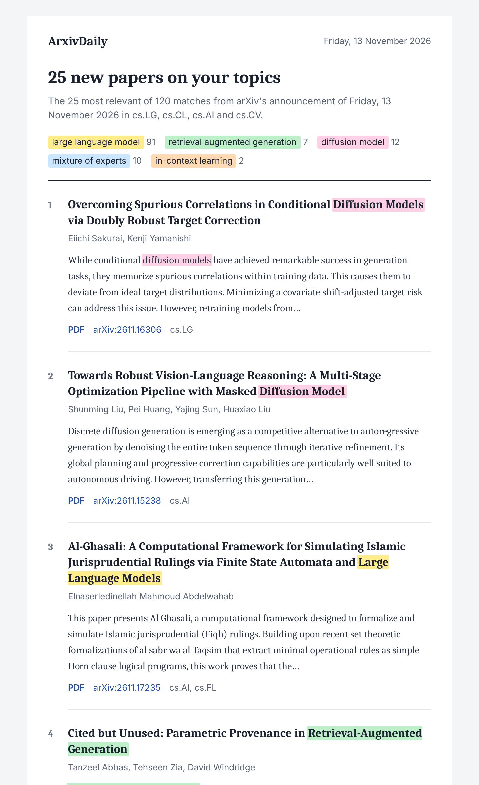
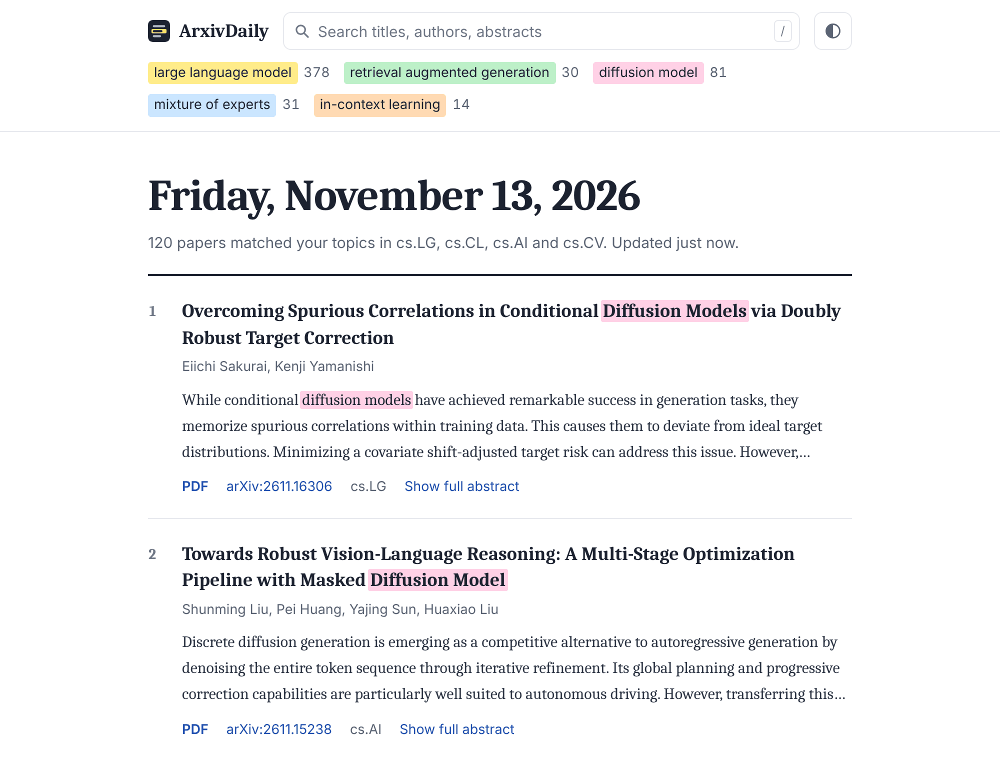
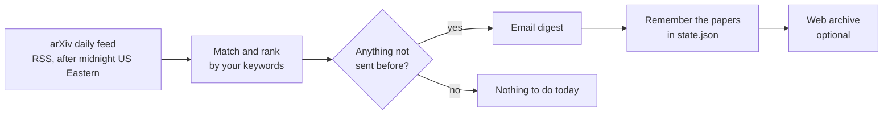

# ArxivDaily

**New arXiv papers on your topics, in your inbox every weekday.** ArxivDaily
reads arXiv's daily announcement, picks the papers that match your keywords,
ranks them, and emails you a clean digest, only when there is something new.
It runs free on GitHub Actions: no server, no database, and nothing to install.

<p align="center">
  
</p>

- **About five minutes of setup:** fork, add two secrets, click *Run workflow*.
- **You see why each paper matched:** every topic gets its own highlighter
  colour in titles and abstracts.
- **Never the same paper twice.** Weekends and quiet days send nothing.
- **Optional web archive** to search and browse past papers. It stays up to
  date by itself, so there's no need to refresh.
- **Works with Gmail, iCloud, Yahoo, QQ, 163, Zoho, Fastmail** and most other
  providers that allow sending by SMTP.

---

## Quick start

You need a GitHub account and an email account that can send mail by SMTP.
Gmail is the easiest, so it's used below; [other providers](docs/setup-guide.md#2-get-an-app-password)
work the same way. The [step-by-step setup guide](docs/setup-guide.md) walks
through every click if you'd like more detail.

### 1. Fork this repository

Click **Fork** (top right of this page), then **Create fork**. In your fork,
open the **Actions** tab and click **I understand my workflows, go ahead and
enable them**. GitHub turns workflows off in new forks until you do this.

### 2. Create an app password

ArxivDaily signs in to your mail account to send the digest. Gmail requires an
*app password* for this; your normal password won't work.

1. Turn on 2-Step Verification for your Google account at [myaccount.google.com/security](https://myaccount.google.com/security) (skip this if it's already on).
2. Open [App passwords](https://myaccount.google.com/apppasswords), type `ArxivDaily` as the name and click **Create**.
3. Copy the 16-letter password that appears. You'll paste it in the next step.

### 3. Add two secrets

In your fork, open **Settings → Secrets and variables → Actions** and click
**New repository secret** for each of these:

| Name | Value |
|---|---|
| `SMTP_USERNAME` | your full Gmail address, e.g. `ada.lovelace@gmail.com` |
| `SMTP_PASSWORD` | the app password from step 2 (spaces don't matter) |

That's all ArxivDaily needs: the mail server is detected from your address,
and the digest goes to that same address. To send it somewhere else (or to
several people), add a third secret, `MAIL_TO`, with comma-separated addresses.

### 4. Choose your topics

Open [`config.json`](config.json), click the pencil icon, and replace the first
two entries with your own keywords and [arXiv categories](https://arxiv.org/category_taxonomy):

```json
  "keywords": ["graph neural network", "molecular generation", "protein folding"],
  "categories": ["cs.LG", "q-bio.BM"],
```

Click **Commit changes**. ArxivDaily checks the file straight away. If you
made a typo, the commit gets a red ✗, and the run page shows the exact line
and what to fix.

### 5. Send yourself a test email

Open **Actions → ArxivDaily → Run workflow**, choose **send test email**, and
click **Run workflow**. Within a minute or two you'll get an email confirming your
settings, with a sample of recent matching papers.

**You're done.** From now on ArxivDaily runs every day after arXiv's nightly
update and emails you whenever new papers match your topics.

> [!TIP]
> Every run writes a short report on its run page in the **Actions** tab:
> what was checked, what matched, and what was sent. Start there whenever
> something looks off, then see [Troubleshooting](docs/troubleshooting.md).

---

## Daily use

| You want to… | Do this |
|---|---|
| Change your topics | Edit `config.json` on GitHub (pencil icon) and commit. |
| Send to other people | Add or edit the `MAIL_TO` secret: `you@x.org, colleague@y.edu`. |
| See what the next email would contain | **Run workflow → preview only (no email)**, then open the run's summary. |
| Get the latest papers again | **Run workflow → resend latest papers**. |
| Pause the emails | **Actions → ArxivDaily → ⋯ → Disable workflow**. Enable it again to resume. |
| Change the delivery time | Edit the two `cron:` lines in `.github/workflows/arxiv_daily.yml`; see [Delivery time](docs/configuration.md#delivery-time). |
| Browse past papers | Turn on the [web archive](#web-archive-optional). |

The **Run workflow** menu has four options:

| Option | What it does |
|---|---|
| **send digest** | The normal daily run: email any new matching papers, then remember them. |
| **send test email** | Checks your email settings and sends a sample. Doesn't change anything. |
| **preview only (no email)** | Shows what would be sent, on the run page and as a downloadable preview. |
| **resend latest papers** | Like *send digest*, but includes papers you've already received. |

## Web archive (optional)

ArxivDaily can also publish a searchable page of everything it has found, at `https://<your-username>.github.io/ArxivDaily/`.

<p align="center">
  
</p>

To turn it on, open **Settings → Pages**, set **Source** to **GitHub Actions**,
then run the workflow once (any option). The address appears on the run page
and in the footer of every email.

The page checks for new papers every few minutes and when you come back to the
tab, so it stays current without refreshing. It loads older days as you
scroll, remembers where you were, and works on phones and in dark mode.
Filter by topic, search titles, authors and abstracts, or press <kbd>/</kbd>
to jump to the search box.

> [!NOTE]
> The web archive is a public page, even if your repository is private (unless
> your organization uses GitHub Enterprise Cloud, which can restrict who sees
> it). Private repositories also need a paid GitHub plan for Pages. The
> archive contains only paper metadata and your topic list, never email
> addresses.

## Configuration

`config.json` controls what ArxivDaily looks for. Only `keywords` is required;
everything else has a sensible default.

| Setting | Default | What it does |
|---|---|---|
| `keywords` | — | Phrases to look for in titles and abstracts. Case, hyphens and plurals don't matter: `"diffusion model"` also finds *Diffusion-Models*. |
| `categories` | all of arXiv | [arXiv categories](https://arxiv.org/category_taxonomy) to watch, e.g. `"cs.CV"`, or a whole archive such as `"physics"`. |
| `ranking.max_papers_per_email` | `25` | The most relevant papers per email. |
| `ranking.min_score` | `1.0` | Raise it to keep only stronger matches. |
| `fetch.include_cross_lists` | `true` | Include papers cross-listed into your categories from elsewhere. |
| `fetch.include_revisions` | `false` | Also include new versions of older papers. |
| `email.abstract_chars` | `320` | How much of each abstract to show. |

The [configuration reference](docs/configuration.md) explains every setting,
the secrets, scoring, and the delivery schedule.

## How it works



1. **Fetch.** After each arXiv announcement (Sunday to Thursday, 20:00 US
   Eastern), arXiv refreshes its per-category feeds at midnight. ArxivDaily
   reads them in one request. If the feed is unavailable, it falls back to
   arXiv's search API, retrying politely when arXiv is busy.
2. **Rank.** Each paper is scored by where your keywords appear (a title hit
   counts 3×, an abstract hit 1×), with a bonus for matching several topics.
3. **Email.** The top papers go out as one email: one copy per recipient, so
   addresses stay private.
4. **Remember.** The paper IDs are committed to `state.json`, so you never get
   a paper twice. That's also why the second daily run sends something only if
   the first one missed it, for example because arXiv was briefly unavailable.
   These small commits also keep GitHub from pausing the schedule, which it
   does in public repositories after 60 days without activity.

## Run it on your computer

ArxivDaily needs only Python 3.9 or newer, with no packages to install.

```bash
python main.py --dry-run --open   # build the email preview and open it in your browser
python main.py --serve            # preview the web archive at http://127.0.0.1:8000
```

To send email locally, copy `.env.example` to `.env` and fill in your two
settings, then try `python main.py --check` followed by
`python main.py --test-email`. The [local usage guide](docs/run-locally.md) has the details.

## Documentation

- [Setup guide](docs/setup-guide.md): every step spelled out, for Gmail, iCloud, Yahoo, QQ, 163 and more.
- [Configuration reference](docs/configuration.md): all settings, secrets, scoring and the delivery schedule.
- [Troubleshooting](docs/troubleshooting.md): what each message on the run page means and how to fix it.
- [Run it on your computer](docs/run-locally.md): previews, tests and local sending.
- [Changelog](CHANGELOG.md): what's new, and how to upgrade from version 1.

## Cost and limits

GitHub Actions is free for public repositories. A run takes well under a
minute, so even a private repository uses only about 60 to 120 of the 2,000
free minutes per month. arXiv's feeds and API are free; ArxivDaily usually
makes a single small request per run, well within
[arXiv's API terms](https://info.arxiv.org/help/api/tou.html).

Thank you to arXiv for use of its open access interoperability. ArxivDaily is
not affiliated with arXiv.
